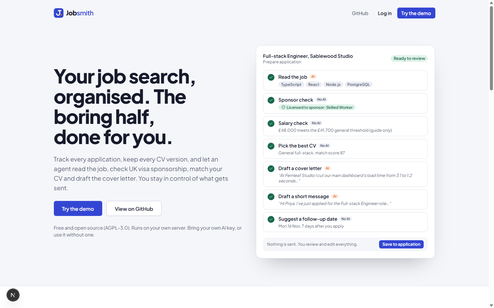
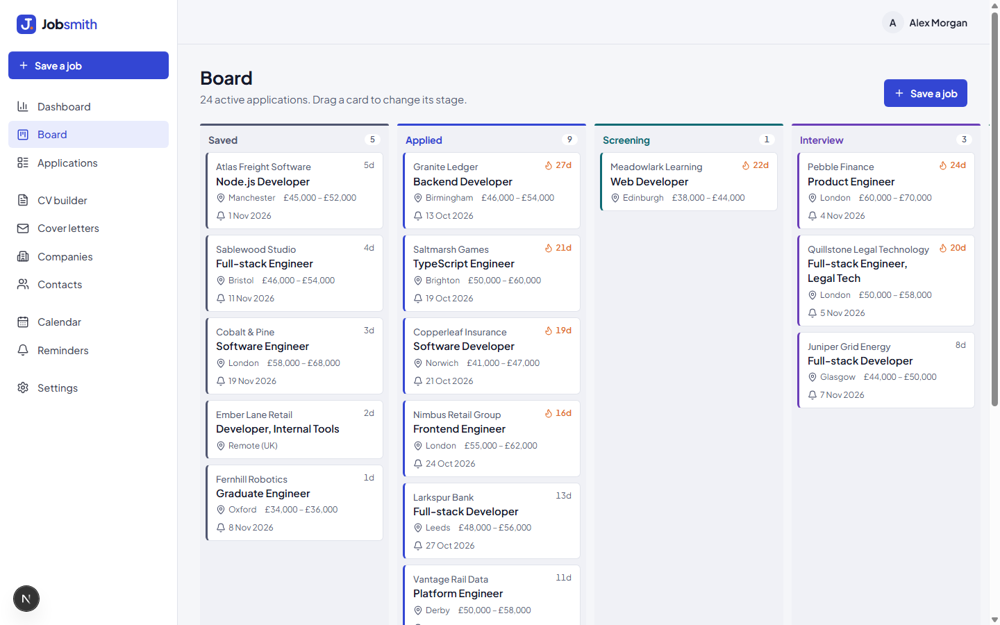
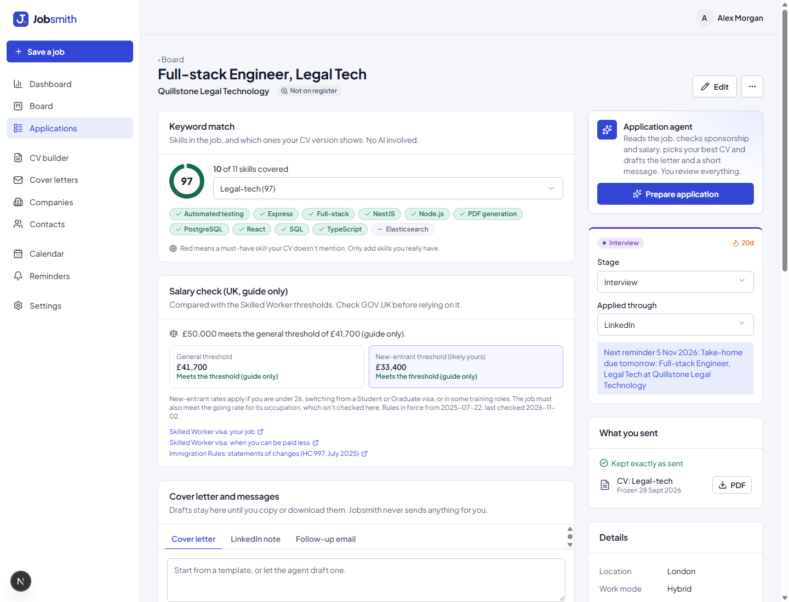
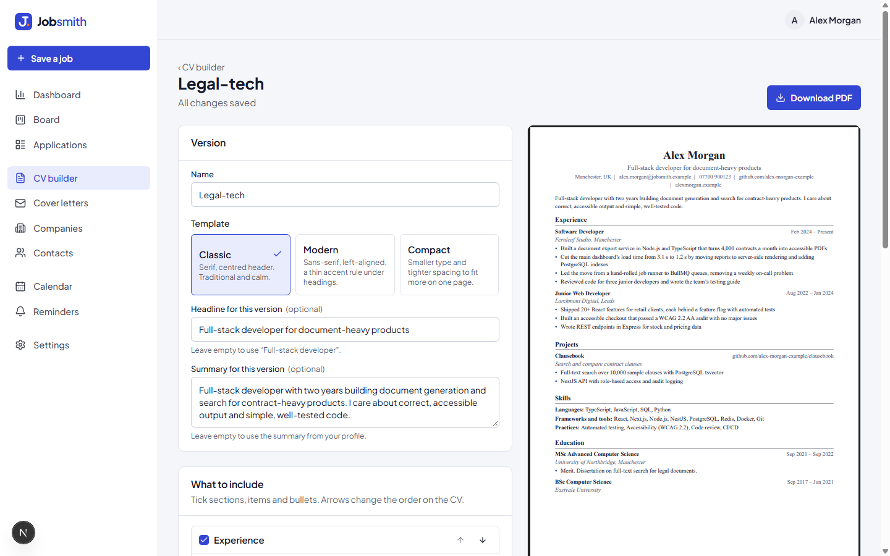
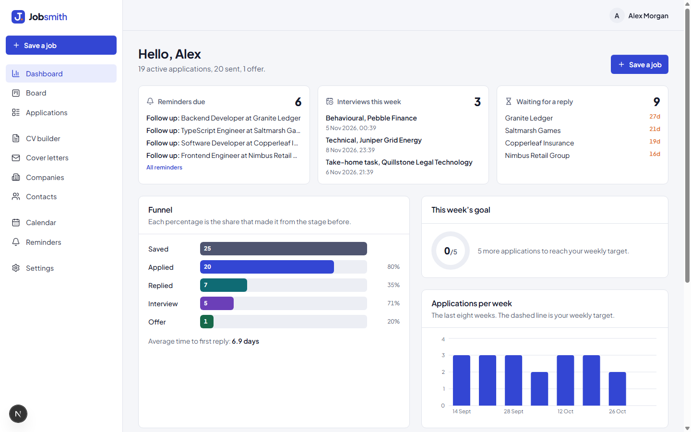
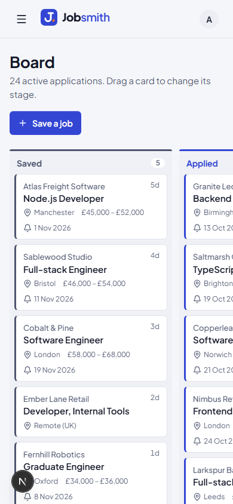
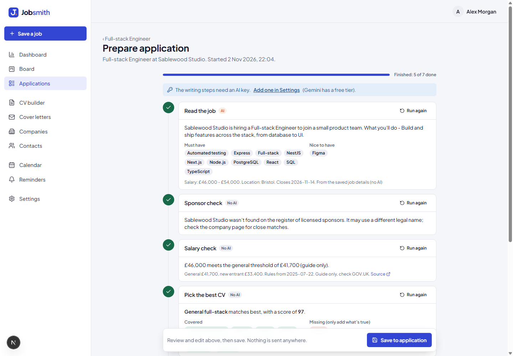

# Jobsmith

[](https://github.com/ToukirOfficial/Jobsmith/actions/workflows/ci.yml)
[](LICENSE)

A free, open-source, self-hosted job search workspace with an AI application agent. Track every application, keep every CV version, and let the agent read the job, check UK visa sponsorship, match your CV and draft the cover letter, while you stay in control of what gets sent.

Bring your own AI key (it works free with Google Gemini), or use it without one. Your data stays on your own server.



**[Try the demo](https://jobsmith.toukirahmedrony.com/demo)** · [Run your own copy](#run-your-own-copy) · Licence: AGPL-3.0

## Contents

- [Why this exists](#why-this-exists)
- [What it does](#what-it-does)
- [How the agent works](#how-the-agent-works)
- [Bring your own key (free with Gemini)](#bring-your-own-key-free-with-gemini)
- [Try the demo](#try-the-demo)
- [Run your own copy](#run-your-own-copy): [email](#email), [backups](#backups), [upgrades](#upgrades), [deploying without Docker](#deploying-without-docker)
- [Architecture](#architecture)
- [Development](#development)
- [Tests](#tests)
- [Licence](#licence)

## Why this exists

I built Jobsmith while applying to dozens of jobs across the UK, Ireland and the EU. My spreadsheet fell apart: which CV version went to which company, when to follow up, which companies could even sponsor a visa, and hours spent rewriting cover letters that all said the same thing.

Jobsmith puts the whole search in one private place and hands the repetitive half of each application to an agent. It's open source so any job seeker can run their own copy and keep their data to themselves.

## What it does

| | |
|---|---|
|  | **Board and table.** Save a job from a link, a pasted advert or a one-click bookmarklet. Drag it from Saved to Applied, Screening, Interview and Offer. Cards show the company, days in the stage (they turn ember after two weeks), the sponsor badge and the next reminder. |
|  | **Everything about an application on one page.** Keyword match against each CV version, the UK salary check with GOV.UK sources, cover letter and message drafts, interviews with prep notes and reflections, contacts, a timeline, and a frozen copy of exactly what you sent. |
|  | **One profile, many CVs.** Write your experience once. Each version picks and orders the bullets it needs, with its own headline. Three clean, ATS-friendly A4 templates with a live preview that matches the exported PDF exactly. |
|  | **Dashboard.** Reminders due, interviews this week, who owes you a reply, your funnel, reply rates by channel, CV version and sponsor status, and a weekly target. |

Also: companies with UK sponsor register status, contacts with a message log, a calendar with a private iCal feed for Google or Apple Calendar, email and in-app reminders, cover letter templates, CSV import from an old spreadsheet, and a full export (JSON, CSV and every PDF in one zip). It works on a phone too.



## How the agent works

Press **Prepare application** on a saved job. Seven steps run in the background and you watch each one go from waiting to running to done:

1. **Read the job** (AI): role, level, must-haves, nice-to-haves, salary and closing date.
2. **Sponsor check** (no AI): is the company on the Home Office register of licensed sponsors, and for which routes.
3. **Salary check** (no AI): the advertised salary against the Skilled Worker general and new-entrant thresholds, from a versioned rules file with effective dates and GOV.UK links. Always a guide only.
4. **Pick the best CV** (no AI): every CV version scored against the job's skills. With a key, the AI adds a two-line explanation.
5. **Draft a cover letter** (AI): plain, specific, in your voice, using only facts from your profile.
6. **Draft a short message** (AI) for the hiring manager or recruiter.
7. **Suggest a follow-up date** (no AI).



**You stay in control.** The agent only prepares. It never applies for jobs, sends emails or messages anyone. You review every result, edit it, and press **Save to application**. Every run is kept with its inputs, outputs, timings and token use, and you can re-run a single step.

**Safety.**

- Each step's output is checked against a schema before it's saved: the right shape, sensible length, and none of the clichés the prompts forbid ("passionate", "keen interest", …). A bad answer is retried once, then shown as a clear error. Nothing invalid is saved.
- **Prompt-injection defence:** job page text is untrusted. It goes into the prompt inside labelled `<untrusted_job_posting>` tags, any closing tag inside the text is removed, and every prompt says the content is data, never instructions. An advert that says "ignore previous instructions" can't change what the agent does, and the evaluation set tests exactly that.
- Steps 2, 3, 4 and 7 are ordinary code and never call the AI.
- Without a key, those four steps still run, and the writing steps say "Add an API key in Settings".

The prompts live in versioned files in [`prompts/`](prompts/), and the evaluation set in [`evals/`](evals/) runs the same files.

## Bring your own key (free with Gemini)

Each person adds their own AI key in **Settings → AI**. Keys are encrypted on the server (AES-256-GCM), never shown again (only the last four characters), never logged and never sent to the browser. You can set a monthly request limit.

- **Google Gemini (default):** create a key at [Google AI Studio](https://aistudio.google.com/apikey). The free tier needs no card. **In plain words:** on the free tier, Google may use what you send (the job advert and your profile) to improve its products, and people may review it. Don't put anything in your profile you wouldn't want shared. The paid tier doesn't use your data that way.
- **OpenAI** or **Anthropic:** paid keys.
- **Any OpenAI-compatible server:** OpenRouter, LM Studio, or Ollama on your own machine. For a local server, the person running Jobsmith must set `AI_ALLOW_LOCAL_ENDPOINTS=true`.

Model names come from Settings or the environment (`AI_MODEL_GEMINI`, `AI_MODEL_OPENAI`, `AI_MODEL_ANTHROPIC`). Everything except the writing steps works with no key at all.

## Try the demo

The [demo](https://jobsmith.toukirahmedrony.com/demo) gives you a private copy of a made-up job search: 25 applications in every stage, three CV versions, interviews, reminders and eight weeks of stats. Three applications (Atlas Freight, Sablewood Studio, Cobalt & Pine) replay a recorded agent run. To try it live, add your own key in Settings: it's encrypted, used only by you, limited to 20 requests, and deleted with your demo after 24 hours. The demo never uses the host's key, never sends email (there's a demo mailbox instead) and only "fetches" three sample adverts.

## Run your own copy

You need Docker.

```bash
git clone https://github.com/ToukirOfficial/Jobsmith.git
cd Jobsmith
cp .env.example .env
```

Edit `.env`:

- `JWT_SECRET`: run `openssl rand -base64 48` and paste the result.
- `ENCRYPTION_KEY`: run `openssl rand -base64 32`. **Back this up.** Without it, saved AI keys can't be read.
- `POSTGRES_PASSWORD`: any long random string.
- `APP_URL`: the address you'll open Jobsmith at, for example `https://jobs.example.com` or `http://localhost:8035`.

Then:

```bash
docker compose up -d
```

This starts the web app, the API, the worker, PostgreSQL and Redis. Open `APP_URL` and **create your account**: the first visitor creates the owner account and the setup page closes for good. To let several people use one copy, set `SIGNUP_ENABLED=true`; each person only ever sees their own data.

Put it behind a reverse proxy with HTTPS (Caddy, nginx or similar) pointing at port 8035. For the agent's live progress, turn off response buffering for `/api/v1/agent-runs/*/stream`.

### Email

Email is used for login codes, password resets and reminders. Without it, Jobsmith still works: you log in with your password only and reminders show in the app. To turn it on:

```
MAIL_TRANSPORT=smtp
MAIL_FROM=Jobsmith <jobs@your-domain.com>
SMTP_HOST=smtp.your-provider.com
SMTP_PORT=587
SMTP_USER=...
SMTP_PASS=...
```

With email on, every login asks for a 6-digit code sent to your address.

### Backups

Back up three things: the PostgreSQL database, the `storage` volume (generated PDFs) and your `.env` (especially `ENCRYPTION_KEY`).

```bash
docker compose exec postgres pg_dump -U jobsmith jobsmith | gzip > jobsmith-$(date +%F).sql.gz
docker run --rm -v jobsmith_storage:/data -v "$PWD":/backup busybox tar czf /backup/storage-$(date +%F).tgz /data
```

You can also download everything from **Settings → Your data → Download my data**.

### Upgrades

```bash
git pull
docker compose up -d --build
```

The API applies database migrations when it starts. Take a backup first.

### Deploying without Docker

`deploy.sh` builds a release on your machine and runs it on your own server under PM2 (web, API and worker), with a database dump before any migration and an automatic switch back if the health check fails. Nothing about your server is committed: copy `deploy.env.example` to `deploy.env` (gitignored) and fill in your SSH alias, user, paths, ports and database name. `./deploy.sh --check` shows what would change without touching anything.

## Architecture

```
apps/web          Next.js (App Router): landing page, the app, the demo. Display only.
apps/api          NestJS + Prisma: every rule, permission and query. Also the BullMQ worker.
packages/shared   Zod schemas and types used by both, plus pure logic (keyword match,
                  salary rules, CV document builder, company name normalisation).
packages/pdf      React templates for the CV and cover letter PDFs (@react-pdf/renderer).
prompts/          Versioned prompt files used by the agent and the evals.
evals/            Agent evaluation cases and README.
data/             UK visa salary rules with sources; demo sample pages and recorded runs.
```

- The browser talks only to the web app; Next.js forwards `/api/*` to NestJS. NestJS checks the session on every request (deny by default) and scopes every query by the signed-in user.
- Sessions are httpOnly cookies with rotating refresh tokens. Passwords use argon2id. Logins, codes and resets are rate-limited.
- Slow work runs in the worker: agent runs, AI calls, job page fetching, PDFs, emails, reminders, imports, exports and the daily sponsor register update.
- PostgreSQL 18 (UUIDv7 ids), Redis for queues, caching and rate limits.

Short decision notes are in [`docs/decisions/`](docs/decisions/).

## Development

Requirements: Node.js 24, pnpm 10, PostgreSQL 18 and Redis.

```bash
pnpm install
cp .env.example .env          # fill in DATABASE_URL, TEST_DATABASE_URL, secrets; COOKIE_SECURE=false
pnpm db:migrate               # apply migrations
pnpm build && pnpm db:seed    # optional: a fictional demo account (see below)
pnpm dev                      # web on :8035, API on :8135, plus the worker
```

The seed creates **demo@jobsmith.example / jobsmith-demo-2026** with a fictional job search. Because its password is public, it is a demo account: the seed only runs with `DEMO_MODE=true` (or `--dev` on a non-production machine, which `pnpm db:seed` passes), and demo accounts can only log in while `DEMO_MODE=true`. To look around locally, set `DEMO_MODE=true` in `.env`; set it back to `false` to use your own account.

A pre-commit hook (installed by `pnpm install`) runs `scripts/scan-secrets.sh`, which stops secrets and public IP addresses from being committed. CI runs it on every file.

## Tests

```bash
pnpm typecheck && pnpm lint && pnpm test && pnpm build
```

The tests run against real PostgreSQL and Redis (a separate `_test` database that is wiped on every run). They cover login and refresh-token rotation, user data isolation across every record route, SSRF protection on job fetching, JobPosting extraction from saved pages, company name normalisation and sponsor matching, salary rule selection by date, CV snapshot immutability, reminders firing once, API key encryption (and that keys are never returned), agent step validation, and demo key expiry.

**The tests never call a real AI.** They use a fake provider. AI quality is measured separately with the evaluation set, run by hand with your own key:

```bash
EVAL_PROVIDER=GEMINI EVAL_API_KEY=your-key pnpm evals
```

## Licence

[AGPL-3.0](LICENSE). Built by [Toukir Ahmed Rony](https://toukirahmedrony.com). If you run a modified Jobsmith for other people, you must share your changes. The sponsor register approach is adapted from [uk-sponsors](https://github.com/ToukirOfficial/uk-sponsors) (MIT).
